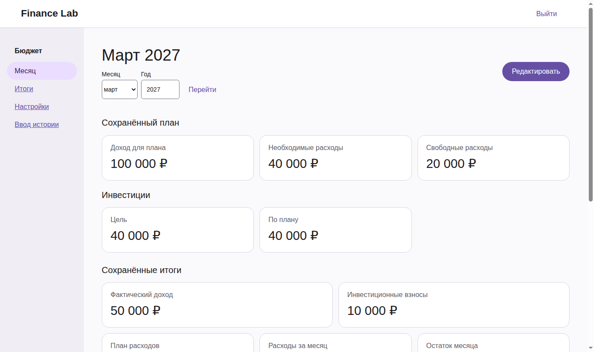

[](https://github.com/finance-lab-project/finance-lab/actions/workflows/verify.yml?query=branch%3Amain+event%3Apush) [](https://github.com/finance-lab-project/finance-lab/releases/latest)

# Finance Lab

Plan a month in rubles, review spending for the year, track investment balances and income, and measure progress toward financial independence. Finance Lab runs on desktop and phone with a Russian-language interface. It uses Java 25, Spring Boot, Thymeleaf and SQLite.

[Try the demo](#run-the-local-fixture) · [Latest published release](https://github.com/finance-lab-project/finance-lab/releases/latest) · [Architecture decision](docs/implementation-approach.md)



[Finance Lab v0.4.0](https://github.com/finance-lab-project/finance-lab/releases/tag/v0.4.0) is live in the single-owner pilot. Budget carries category balances into the next month and handles the January rollover. Investments tracks month-end balances and credited income alongside Budget contributions. FIRE shows progress toward separate capital and monthly passive-income goals.

## Run the local fixture

Try the published v0.4.0 demo with JDK 25, curl, OpenSSL, shasum and a POSIX shell. The example creates a separate temporary directory and a fresh SQLite database. It runs with synthetic data and two disposable accounts.

```sh
demo_dir="$(mktemp -d)" && cd "$demo_dir" || exit 1
release_url="https://github.com/finance-lab-project/finance-lab/releases/download/v0.4.0"
curl -fLO "$release_url/finance-lab-0.4.0.jar" &&
  curl -fLO "$release_url/finance-lab-0.4.0.jar.sha256" &&
  shasum -a 256 -c finance-lab-0.4.0.jar.sha256 || exit 1
export BUDGET_DB="$demo_dir/demo.sqlite"
export BUDGET_OWNER_A_PASSWORD="$(openssl rand -hex 12)"
export BUDGET_OWNER_B_PASSWORD="$(openssl rand -hex 12)"
printf 'owner-a password: %s\n' "$BUDGET_OWNER_A_PASSWORD"
java --enable-native-access=ALL-UNNAMED -jar finance-lab-0.4.0.jar --spring.profiles.active=demo
```

Open [the local budget](http://127.0.0.1:8080/) and sign in as `owner-a` with the printed password. March 2027 opens with 50,000 ₽ of actual income, 10,000 ₽ of investment contributions and 6,000 ₽ spent on food. Choose **Редактировать** to change a figure, then **Сохранить** to see the updated month. Stop the app with Ctrl+C. For a source build, empty budget or two-device walkthrough, see the [fixture guide](docs/budget-pilot-guide.md#run-the-local-fixture).

## Documentation

[Wiki home](https://github.com/finance-lab-project/finance-lab/wiki) is a short guide to the demo, architecture and release process.

- [Budget scope](docs/product-scope.md) and [monthly workflow with examples](docs/budget-v1-user-journey.md)
- [Screen designs](docs/budget-v1-screen-sketches.md) and [prototype walkthrough](docs/budget-v1-prototype-review.md)
- [Implementation decision](docs/implementation-approach.md) and [sprint review workflow](ops/agents/README.md)

## Releases

[Published releases](https://github.com/finance-lab-project/finance-lab/releases) include the deployed revision, user-visible changes, JAR and checksum. The [weekly release procedure](docs/budget-pilot-guide.md#releases) covers the Saturday backup, deployment verification and recovery. The [v0.4.0 delivery baseline](https://github.com/finance-lab-project/finance-lab/issues/63) records how long the six shipped features took to reach production.

## Run the private pilot

The [private pilot runbook](docs/private-pilot.md) covers owner sign-in, the persistent database and the systemd service. The [backup procedure](docs/sqlite-backup.md) covers the weekly SQLite backup.

<a id="issue-9-verification--14-november-2026"></a>

[November 2026 phone, browser and persistence checks](docs/budget-pilot-guide.md#issue-9-verification--14-november-2026)

## Earlier implementation

The [archived application](https://github.com/finance-lab-project/app) preserves the earlier Java/Vaadin and PostgreSQL implementation.
