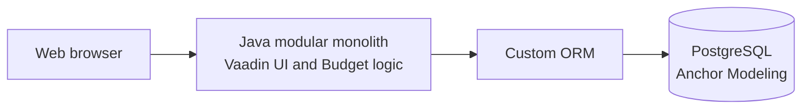
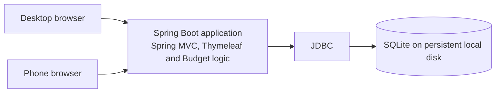

# From Overengineering to Pragmatic Architecture: An Evolutionary Case Study of Finance Lab

## Abstract

Finance Lab moved from a browser-local budgeting frontend and a separate AI learning experiment to a Java/Vaadin application backed by PostgreSQL, then to a Spring Boot and SQLite pilot. The final decision prioritized a shared saved budget on desktop and phone for one owner with occasional writes. The earlier PostgreSQL application reached deployment, and the SQLite pilot passed recorded release-candidate checks. The record supports a change in deployment topology and documents selected workflows. Comparative delivery speed, maintenance effort, and operating costs remain unmeasured. [Evidence timeline][evidence] · [Pilot decision][spring] · [Launch record][launch]

## Project context and constraints

The pilot needed one owner to enter a monthly budget, review spending and historical entries, and open the same saved figures from a desktop or phone browser. A connected browser, one application instance, durable local disk, and occasional short writes defined the operating assumptions. The earlier browser-local frontend could preserve data in the same browser and transfer it by export and restore. The pilot needed a common authoritative copy that both devices could read after a save. [Frontend settings PR][fe35] · [Pilot decision][spring] · [Launch record][launch]

Learning objectives and shipping a product called for different evidence. The Python experiment tested whether a model could request a narrowly scoped tool and receive a validated synthetic result. Shipping the budgeting pilot required a repeatable save, cross-device readback, persistence across restart, and a backup that could be checked outside the VM. Those were separate milestones with separate acceptance evidence. [Tool run][tool] · [Launch record][launch]

## Methodology and evidence

This retrospective uses the issue #26 archive, decision records for intent, commits and PRs for recorded implementation, CI for automated results, and the launch issue for reported deployment observations. A design may be planned, implemented, tested, or deployed. Each status applies to the specific behavior or revision cited. Historical runs are reported from their records. The report labels inferred effects as hypotheses and gives author recollection lower weight when the source history is incomplete. [Issue #26 evidence archive][evidence]

## Chronological designs

### 1. Browser-local frontend and separate learning prototype, September to early November 2026

A September commit initialized Vite, React, and TypeScript. The author's identification of that repository as the project starting point is retrospective. The later frontend import and Settings PR document budgeting with browser-local persistence and manual backup. That design kept persistence within the browser and gave the user an explicit way to transfer data. The original stack-selection rationale is undocumented. [Frontend initialization commit][frontend-init] · [Frontend import PR][fe1] · [Frontend settings PR][fe35] · [Evidence timeline][evidence]

In October, a separate Python prototype implemented a Yandex AI Studio adapter and exercised a read-only budget tool against synthetic data. The observed live run shows that a model could request the tool and a local function could validate the requested month and return a fixture. ADR-026 identified this repository as a learning prototype and proposed a future product agent with least privilege and human-approved writes. The proposed product-agent safeguards are a plan. The fixture-backed tool was implemented and tested in the prototype. The records do not establish why the model provider was chosen or how this work influenced the Java rewrite. [Model run][live] · [Adapter commit][adapter] · [Tool run][tool] · [ADR-026][adr]

### 2. Java/Vaadin and PostgreSQL, 4–10 November 2026

The roadmap selected a Budget-first Java modular monolith. Vaadin handled the UI in the Java application, which ran without Spring. A custom ORM mapped application data to PostgreSQL using Anchor Modeling. Keeping UI and application logic in one deployable while controlling database mappings is a plausible rationale inferred from the design. The records establish the chosen design and roadmap priority. The full selection rationale and evaluated alternatives are undocumented. [Platform planning PR][pf21] · [Vaadin architecture decision][vaadin]

The ORM and PostgreSQL integration were implemented and tested. The Budget release record reports live acceptance on 10 November on a single VM. Centralized relational persistence supported a server-owned budget. Maintaining custom mappings and checking their behavior against PostgreSQL formed part of the engineering work. [ORM PR #16][app16] · [Budget PR #12][app12] · [Launch record][launch]

### 3. Spring Boot and SQLite, 14–21 November 2026

The screen walkthrough reached desktop setup. Phone use and additional paths were reviewed on prepared screens, so the decision prioritized a working save to verify arbitrary input, persistence, and cross-device access. The accepted decision put validation, calculations, and saves in one Spring Boot application. Spring MVC and Thymeleaf served responsive HTML to both device types, and JDBC saved data in SQLite on persistent local disk. A single owner and occasional short writes made serialized writes acceptable for the intended pilot. Embedding the database removed a separate database service from this deployment topology while keeping one authoritative server-side budget. The application still required durable storage, schema maintenance, backups, and recovery checks. [Decision PR #8][spring8] · [Accepted implementation decision][spring]

The release record identifies v0.1.0 and the deployed revision. The shipped scope included first use with an empty budget, monthly plans and spending, historical entry, and a yearly overview. The decision to use server-rendered forms and embedded persistence was made for the connected one-owner workload. The records establish no measured benefit attributable to the UI framework, data model, or database engine individually. [Release][release] · [Deployed commit][revision] · [Launch record][launch]

## Alternatives and decision matrix

The comparison evaluates fit for the connected one-owner pilot. Delivery and maintainability judgments are qualitative. The accepted decision compares SQLite with PostgreSQL for the same Spring MVC application. The retained frontend and retained Vaadin rows are retrospective alternatives. [Evidence timeline][evidence] · [Accepted implementation decision][spring]

| Option | Complexity and maintainability | Operating burden | Delivery speed | Scaling and data consistency |
| --- | --- | --- | --- | --- |
| Retain the browser-local React frontend | Browser owns storage and backup UX. Shared online state would require additional design. | Browser data and manual exports require user care. | Reuse could shorten single-device work. Cross-device saves would add work. Both are hypotheses. | Each browser owns its copy. Export and restore transfer snapshots without automatic reconciliation. |
| Retain Vaadin, PostgreSQL, Anchor Modeling, and the custom ORM | One Java deployable. Explicit mappings provide control but need maintenance and integration tests. | PostgreSQL adds database access, upgrades, and backup responsibilities, some of which a managed service could take on. | Reusing shipped capabilities could save rewrite work. Future mapping effort is unmeasured. | PostgreSQL supports concurrent writers and separately hosted persistence. Application transaction design still determines consistency of budget operations. |
| Use Spring MVC and Thymeleaf with PostgreSQL | Shared server forms with a database service. Retaining Anchor Modeling and the ORM would be a separate design choice. | Keeps database service and recovery responsibilities. | Development and integration testing need a database instance and connection. The relative delivery cost is unknown. | A shared database could support multiple application instances. Concurrent edits would still need explicit conflict rules. |
| Adopt Spring Boot, Spring MVC, Thymeleaf, and SQLite | Shared server forms and JDBC persistence. Schema changes and SQLite semantics still require maintenance. | One application with a persistent local file. Backup and restore procedures remain necessary. | A durable local file was sufficient to start testing cross-device saves. A smaller service topology may reduce setup work, though comparative lead time is unmeasured. | One authoritative copy for online devices. Short writes serialize. The chosen topology assumes one instance with durable local storage. |

## Architecture diagrams

*Figure 1. Earlier Budget architecture released on 10 November 2026. The browser uses the Vaadin application, whose custom ORM maps Budget data to PostgreSQL. The arrows show application dependencies. Sources are the Vaadin decision and release PR.* [Architecture decision][vaadin] · [Release PR][app12]

*Figure 2. One-owner pilot architecture recorded for v0.1.0 on 21 November 2026. Desktop and phone use the same application and persisted budget. The arrows show request and persistence paths. Sources are the accepted decision and launch record.* [Accepted decision][spring] · [Launch record][launch]

## Verified implementation and test results

| Stage | Status and recorded evidence | Verification scope |
| --- | --- | --- |
| Early frontend | Implemented. The import PR reports tests for monthly budgets, local storage, and export/restore. | Browser-local behavior. [Frontend import][fe1] |
| Python learning prototype | Implemented and tested. PR #3 reports 15 offline tests using fake transports. PR #4 reports 57 offline tests including the read-only tool. Dated notes record live model and tool experiments. | Synthetic data and selected model interactions. Product-agent deployment remains unverified. [PR #3][agent3] · [PR #4][agent4] · [Live run][live] · [Tool run][tool] |
| Vaadin release | Implemented, tested, and deployed as reported. PR #16 records six ORM unit tests and 75 PostgreSQL integration tests. Separate probes reproduced a Budget category-history defect, and PR #12 records the fix and release. | Authenticated browser checks covered deployed read paths. Saves and restart persistence were exercised with a separate database on the selected VM. [ORM PR][app16] · [Release PR][app12] |
| Spring Boot pilot | Implemented, tested, and deployed. Candidate CI recorded 20 Maven tests with zero failures, errors, or skips. At launch, the owner signed in over HTTPS, saved a synthetic entry on desktop, and read it on a physical phone. Both devices showed the saved entry after the rehearsal service restarted. | Candidate tests and the launch observations below cover specific save, restart, and backup paths. Sustained usage remains unverified. [Candidate CI][ci] · [Launch record][launch] |

**Local restore rehearsal.** The packaged candidate restored a synthetic budget into a fresh SQLite database. The restored figures matched the saved figures, and an edit to the restored copy left the source data intact. Issue #24 records that the tested candidate (`ed173d2`) and the deployed revision (`220cfdb`) had identical source trees. [Release PR #34][release-pr] · [Launch record][launch] · [Deployed commit][revision]

**Launch backup check.** The initial encrypted backup of the empty live budget passed storage readback, independent off-VM decryption, SQLite integrity checks, and an empty-budget check. This verified the contents of that backup. Recovery of the service on replacement infrastructure after loss of the VM remains unverified. [Launch record][launch]

## Lessons

The prototype's narrow fixture-backed contract was suited to testing tool behavior. The product pilot needed evidence about saved data and device access. Choosing an acceptance check for each goal made the distinction concrete. [Tool run][tool] · [Launch record][launch]

Both server implementations kept application delivery within a monolith. The main structural change was the UI and data-access path and the move from a separate database service to embedded persistence. The record supports that narrower claim. Whether that choice made maintenance or delivery easier remains a hypothesis. [Vaadin decision][vaadin] · [Accepted implementation decision][spring]

## Limitations and AI attribution

This is a single-project retrospective based on repository and participant records. It has no controlled comparison, workload benchmark, operating-cost baseline, or measured lead times. The stack changed across several layers at once, so the release records cannot isolate individual effects. The evidence archive also leaves gaps in the early selection rationale and long-term production behavior. This draft uses public project references and synthetic-data descriptions for factual, privacy, and editorial review. [Evidence timeline][evidence]

Prototype PR #3 credits Codex with implementation corrections and tests. The run record documents Yandex AI Studio as the model provider for the prototype. Its role in application code authorship or production data access is unverified. ADR-026 treats a planned product agent as distinct from engineering assistance. Codex assisted with drafting this report from the issue #26 archive. Authorial credit and responsibility for the publication draft are pending review. [Prototype PR #3][agent3] · [Live run][live] · [ADR-026][adr]

## Future change triggers

- Reassess PostgreSQL if observed write contention causes repeated save failures or unacceptable delays, or if the hosting platform cannot provide durable local storage. Measure contention and recovery against the workload before selecting a replacement. [Accepted implementation decision][spring]
- Revisit the deployment topology when availability requirements justify independent storage or multiple application instances. Specify concurrent-edit behavior and recovery objectives before changing the topology. [Accepted implementation decision][spring]
- Consider richer temporal modeling if audited history or reconstruction of past budget states becomes a concrete requirement beyond the present history workflow. Compare extra mapping and migration work with the specific query and correctness requirements. This is a prospective decision criterion. [Vaadin decision][vaadin] · [Launch record][launch]
- Revisit client-side persistence and synchronization if offline editing becomes a product requirement. Define conflict resolution and recovery across devices first. This is a prospective decision criterion. [Frontend settings PR][fe35] · [Accepted implementation decision][spring]

## Draft citation and repository metadata

Suggested citation for review: [Confirmed author(s)]. ([Publication year]). *From Overengineering to Pragmatic Architecture: An Evolutionary Case Study of Finance Lab* (v0.1 draft). Finance Lab technical report. [Version DOI once assigned].

| Field | Draft value |
| --- | --- |
| Resource type and language | Technical report, English |
| Version and evidence cutoff | v0.1 draft, evidence reviewed through 26 November 2026 |
| Keywords | Software architecture evolution, personal budgeting, modular monolith, SQLite, PostgreSQL, architecture decision records |
| Creators, identifiers, publication date, and license | Pending confirmation before submission |
| Related identifiers | Issue #26 evidence archive, v0.1.0 software release, and deployed source revision [Evidence archive][evidence] · [Software release][release] · [Source revision][revision] |
| Canonical source | `docs/architecture-evolution/report.md` with embedded editable Mermaid |

## References

- [Issue #26 architecture evidence and timeline](evidence.md)
- [Accepted Spring Boot and SQLite implementation decision](https://github.com/finance-lab-project/finance-lab/blob/b158ae68e6d6a0f415ade9fc8430238e60869121/docs/implementation-approach.md#L3-L25)
- [Release PR #34, packaged candidate and local restore rehearsal](https://github.com/finance-lab-project/finance-lab/pull/34)
- [Issue #24, private pilot launch verification](https://github.com/finance-lab-project/finance-lab/issues/24)
- [Frontend settings PR](https://github.com/finance-lab-project/frontend/pull/35)
- [Python prototype read-only budget tool run](https://github.com/anton415/finance-lab-agent/blob/e46ffee744661117654e54ec048908be61c520fd/docs/t1/t1-2-read-only-budget-tool.md)
- [Frontend initialization commit](https://github.com/anton415/finance-lab/commit/c6a542972c1ad2738cc708c49fbe72e13d1c84f6)
- [Frontend import](https://github.com/finance-lab-project/frontend/pull/1)
- [Python prototype live model call record](https://github.com/anton415/finance-lab-agent/blob/1996491138679510a32824defdcae8d7b453bf0b/docs/t1/day2-yandex-model-call.md#L3-L23)
- [Adapter commit](https://github.com/anton415/finance-lab-agent/blob/1996491138679510a32824defdcae8d7b453bf0b/src/finance_lab_agent/yandex.py)
- [ADR-026](https://github.com/anton415/finance-lab/blob/a214a664f5409e91c10ec4468a53c2a104936bc5/docs/architecture/decisions/0026-least-privilege-ai-agent-human-approved-writes.md#L3-L13)
- [Platform planning PR](https://github.com/finance-lab-project/platform/pull/21)
- [Vaadin decision](https://github.com/finance-lab-project/app/blob/43d51524ad1c8938b57624b1a9ee393da72d42e4/docs/architecture.md#L3-L29)
- [App PR #16, custom ORM and PostgreSQL integration](https://github.com/finance-lab-project/app/pull/16)
- [App PR #12, Budget fix and release](https://github.com/finance-lab-project/app/pull/12)
- [Decision PR #8](https://github.com/finance-lab-project/finance-lab/pull/8)
- [Finance Lab v0.1.0 release](https://github.com/finance-lab-project/finance-lab/releases/tag/v0.1.0)
- [Source revision](https://github.com/finance-lab-project/finance-lab/commit/220cfdb47b737f248192b396dbf5c3185407ac3a)
- [Agent PR #3, adapter corrections and offline tests](https://github.com/anton415/finance-lab-agent/pull/3)
- [Agent PR #4, read-only budget tool and tests](https://github.com/anton415/finance-lab-agent/pull/4)
- [Budget v0.1.0 release-candidate CI job](https://github.com/finance-lab-project/finance-lab/actions/runs/44869615186/job/136740965177)

[evidence]: evidence.md
[spring]: https://github.com/finance-lab-project/finance-lab/blob/b158ae68e6d6a0f415ade9fc8430238e60869121/docs/implementation-approach.md#L3-L25
[release-pr]: https://github.com/finance-lab-project/finance-lab/pull/34
[launch]: https://github.com/finance-lab-project/finance-lab/issues/24
[fe35]: https://github.com/finance-lab-project/frontend/pull/35
[tool]: https://github.com/anton415/finance-lab-agent/blob/e46ffee744661117654e54ec048908be61c520fd/docs/t1/t1-2-read-only-budget-tool.md
[frontend-init]: https://github.com/anton415/finance-lab/commit/c6a542972c1ad2738cc708c49fbe72e13d1c84f6
[fe1]: https://github.com/finance-lab-project/frontend/pull/1
[live]: https://github.com/anton415/finance-lab-agent/blob/1996491138679510a32824defdcae8d7b453bf0b/docs/t1/day2-yandex-model-call.md#L3-L23
[adapter]: https://github.com/anton415/finance-lab-agent/blob/1996491138679510a32824defdcae8d7b453bf0b/src/finance_lab_agent/yandex.py
[adr]: https://github.com/anton415/finance-lab/blob/a214a664f5409e91c10ec4468a53c2a104936bc5/docs/architecture/decisions/0026-least-privilege-ai-agent-human-approved-writes.md#L3-L13
[pf21]: https://github.com/finance-lab-project/platform/pull/21
[vaadin]: https://github.com/finance-lab-project/app/blob/43d51524ad1c8938b57624b1a9ee393da72d42e4/docs/architecture.md#L3-L29
[app16]: https://github.com/finance-lab-project/app/pull/16
[app12]: https://github.com/finance-lab-project/app/pull/12
[spring8]: https://github.com/finance-lab-project/finance-lab/pull/8
[release]: https://github.com/finance-lab-project/finance-lab/releases/tag/v0.1.0
[revision]: https://github.com/finance-lab-project/finance-lab/commit/220cfdb47b737f248192b396dbf5c3185407ac3a
[agent3]: https://github.com/anton415/finance-lab-agent/pull/3
[agent4]: https://github.com/anton415/finance-lab-agent/pull/4
[ci]: https://github.com/finance-lab-project/finance-lab/actions/runs/44869615186/job/136740965177
